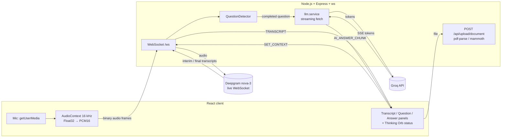

# Real-Time Interview Assistant (POC)

Listens to an interviewer through the browser mic, transcribes the audio live,
detects when a question has been asked, and streams a short, personalised
suggested answer to the screen in about 1–2 seconds.

```
Mic audio → WebSocket → Deepgram (streaming STT) → question detection → Groq LLM (streaming) → React UI
```

---

## Features

- **Live transcript.** Final text is shown in white and interim (still changing) text in grey italics.
- **Automatic question detection** based on Deepgram's end-of-speech signal.
- **Answers stream token by token** from Groq over the same WebSocket.
- **Candidate context.** Paste or upload (PDF/DOCX) a resume and a job description. Answers are grounded in them, and the prompt forbids inventing experience.
- **Clear status indicator.** The header shows one of these states: `Ready → Connecting → Listening → Thinking → Answering`. Each state uses a different animated orb from [Thinking Orbs](https://libraries.dev/orbs).
- **Latency metrics in the UI.** The header shows time to first token and total time, measured from question detection.

### UI: Thinking Orbs

The status indicator uses **[Thinking Orbs](https://libraries.dev/orbs)**
(`thinking-orbs` on npm, MIT), a set of animated dotted-orb loading indicators
for AI interfaces by [libraries.dev](https://libraries.dev). Each assistant phase
maps to one orb animation (see `client/src/components/StatusOrb.tsx`):

| Phase      | Orb state    | Meaning                                    |
|------------|--------------|--------------------------------------------|
| Offline    | `connecting` (paused) | Backend not reachable             |
| Ready      | `breathing`  | Connected, not listening                   |
| Connecting | `connecting` | Opening the Deepgram session + mic         |
| Listening  | `listening`  | Streaming audio, waiting for a question    |
| Thinking   | `solving`    | Question detected, waiting for first token |
| Answering  | `composing`  | Answer tokens streaming in                 |

The orb is tinted per phase, so the state can be read at a glance during a live
call. Only the library's free states and sizes (64 px and 20 px) are used.

---

## Setup (clean machine)

**Requirements:** Node.js 20+ (uses the built-in `fetch`), npm, and Chrome or Edge.

**API keys (free tiers are enough):**
- Deepgram: https://console.deepgram.com (comes with free credit)
- Groq: https://console.groq.com/keys (free tier)

```bash
git clone https://github.com/Lucifer180/interview-assistant.git
cd interview-assistant

# 1. Backend
cd server
npm install
cp .env.example .env        # then fill in DEEPGRAM_API_KEY and GROQ_API_KEY
npm run dev                 # http://localhost:4000, ws://localhost:4000/ws

# 2. Frontend (new terminal)
cd client
npm install
npm run dev                 # http://localhost:5173
```

Open http://localhost:5173 and allow microphone access. Optionally paste or upload
your resume and the JD, then click **Save context**. Click **Start listening** and
ask a question out loud.

### Environment variables (`server/.env`)

| Variable           | Default                  | Notes                         |
|--------------------|--------------------------|-------------------------------|
| `PORT`             | `4000`                   | HTTP + WebSocket port         |
| `CLIENT_ORIGIN`    | `http://localhost:5173`  | CORS origin for uploads       |
| `DEEPGRAM_API_KEY` | —                        | Required                      |
| `GROQ_API_KEY`     | —                        | Required                      |
| `GROQ_MODEL`       | `openai/gpt-oss-120b`    | Any Groq chat model           |

Keys are only read on the server. They are never sent to the browser, and
`.env` is git-ignored.

---

## Architecture



**Data flow**

1. The browser captures the mic, resamples it to 16 kHz mono and converts it to
   PCM16. The audio is sent as **binary** WebSocket frames.
2. The server forwards the frames to a Deepgram live session, one per client
   connection.
3. Deepgram returns interim and final transcripts. The server sends every
   result to the UI (`TRANSCRIPT`) and passes final ones to the `QuestionDetector`.
4. When the detector emits a complete question, the server sends
   `QUESTION_DETECTED` and calls Groq with `stream: true`. It parses the SSE stream
   and forwards each token as `AI_ANSWER_CHUNK`, then sends `AI_ANSWER_COMPLETE`.
5. Resume and JD text is stored per connection (`SET_CONTEXT`) and injected into
   the prompt.

**WebSocket protocol**

| Direction | Message | Purpose |
|---|---|---|
| client → server | `START` / `STOP` | Open / close the Deepgram session |
| client → server | binary | PCM16 audio frames |
| client → server | `SET_CONTEXT` | Resume + JD text |
| server → client | `CONNECTED`, `STATUS` | Lifecycle (`LISTENING`, `STOPPED`) |
| server → client | `TRANSCRIPT` | `{ transcript, isFinal, speechfinal }` |
| server → client | `QUESTION_DETECTED` | Completed question |
| server → client | `AI_ANSWER_START` / `_CHUNK` / `_COMPLETE` / `_ERROR` | Streamed answer |
| server → client | `CONTEXT_SAVED`, `ERROR` | Acks and errors |

**Code layout**

```
server/src
  config/env.ts                    zod-validated env vars
  websocket/websocket.server.ts    connection lifecycle + message routing
  services/deepgram.service.ts     Deepgram live session wrapper
  services/question-detector.service.ts
  services/llm.service.ts          Groq streaming (SSE parsing)
  services/document.service.ts     PDF / DOCX text extraction
  routes/upload.routes.ts          multer upload endpoint
client/src
  hooks/useInterviewSession.ts     socket + mic lifecycle, derived UI phase, latency
  services/audio.services.ts       mic capture → PCM16
  components/StatusOrb.tsx         phase → Thinking Orb mapping
  components/ContextPanel.tsx      resume / JD input + upload
  components/AnswerText.tsx        safe mini-markdown renderer for streamed answers
  App.tsx                          single-screen layout
```

---

## Key decisions and trade-offs

**Speech-to-text: Deepgram `nova-3` (streaming)**
- It has a true streaming WebSocket API with interim results and end-of-speech
  signals (`speech_final`, `utterance_end_ms`). That gives question detection for
  free instead of me building voice activity detection.
- It has low latency and good accuracy on technical vocabulary, plus a generous
  free tier.
- Trade-off: it is a paid cloud dependency. A local Whisper setup would be free and
  private, but streaming Whisper adds noticeably more latency.

**LLM: Groq (`openai/gpt-oss-120b`)**
- The 3-second budget is dominated by time to first token, and Groq's inference
  hardware is very fast. I measured about **0.8 s to the first token and
  about 1.5 s for a full answer**.
- It has an OpenAI-compatible API, so the streaming code is plain `fetch` + SSE parsing
  with no SDK. Swapping providers only means changing the URL and model.
- Trade-off: the model catalogue changes (a Llama model I first tried had been
  retired), so the model name is configurable.

**Question detection: end of speech + buffering**
- Deepgram is configured with `endpointing: 300` ms. Final segments are
  appended to a buffer, and when Deepgram flags `speech_final` (the speaker paused)
  the buffer is emitted as one complete question.
- This is simple, adds no extra latency, and handles questions that Deepgram
  splits across several final segments.
- Trade-off: a pause is not the same as a question. Mid-sentence hesitation can cut a
  question early, and filler like "okay, great" is currently also sent to the LLM.
  See *Known limitations* and *Next steps*.

**Transport: one WebSocket for everything**
- Audio goes up as binary frames and JSON events come down on the same socket, so
  there is one connection, ordered delivery and simple lifecycle handling.

**Audio: `ScriptProcessorNode` at 16 kHz**
- This was the quickest reliable way to get PCM16 within the time box.
  `ScriptProcessorNode` is deprecated, and `AudioWorklet` is the production choice.

**Context: resume + JD injected into every prompt**
- The system prompt tells the model to personalise from the resume and **never
  invent experience**. If the resume doesn't cover a topic, it answers from general
  knowledge instead.

**UI**
- One screen. The question and answer are on the right in large type because that is
  what you read mid-call. The context and transcript are on the left. The status orb
  and the Start/Stop button stay in a sticky header.

### Latency

| Stage | Approx. |
|---|---|
| End of speech → `speech_final` (Deepgram endpointing) | ~300–500 ms |
| Question → first Groq token (measured) | ~0.8 s |
| **End of question → first answer token** | **~1.1–1.5 s** (target < 3 s) |

The UI shows time to first token and total time for every answer. It is measured
in the browser from `QUESTION_DETECTED`, so it excludes the endpointing delay.

---

## Known limitations

- **Pauses are treated as questions.** There is no filler or small-talk filter yet,
  and long pauses mid-question split it in two.
- **Overlapping answers.** If a second question is detected while the first answer is
  still streaming, both streams run and their tokens interleave. Earlier requests
  should be cancelled with an `AbortController`.
- **Answer length isn't strictly enforced.** The prompt asks for concise answers
  but doesn't hard-limit them to 60–90 words, and it sometimes includes code samples.
- **Mic only.** No tab or system audio capture (`getDisplayMedia`), so the
  interviewer must be audible through the speakers. There is also no speaker
  separation, so the candidate's own speech is transcribed too.
- **The audio pipeline assumes the browser honours a 16 kHz `AudioContext`**
  (Chrome and Edge do). It uses the deprecated `ScriptProcessorNode`.
- **No reconnect logic.** If the backend restarts, reload the page.
- **The context lives in memory per WebSocket connection** and is lost on reload.
- **The backend URL is hard-coded to `localhost:4000`.**
- **No conversation memory**, so follow-up questions don't see earlier Q&A.

---

## What I'd build next with another week

1. **Smarter question detection.** Run a fast LLM classifier (or a heuristic of
   question words plus a trailing "?") on each `speech_final` segment to drop
   filler, and wait for `UtteranceEnd` before treating a short fragment as complete.
2. **Cancel stale answers.** Abort the in-flight Groq request when a new question
   arrives, and show the previous Q&A in a history list.
3. **Tab audio capture** with `getDisplayMedia` plus Deepgram diarization, so only the
   interviewer's speech is answered.
4. **Answer modes per question type** (technical / behavioural with STAR / HR), with
   a hard 60–90 word budget.
5. **Reliability.** WebSocket auto-reconnect with backoff, an `AudioWorklet` with
   proper resampling, rate limiting, and env-based URLs.
6. **Conversation memory** for follow-up questions, plus Docker Compose for one-command setup.

---

## Credits

- Status orbs: [Thinking Orbs](https://libraries.dev/orbs) by Jakub Antalik / libraries.dev (MIT)
- Speech-to-text: [Deepgram](https://deepgram.com)
- LLM inference: [Groq](https://groq.com)
- Icons: [lucide-react](https://lucide.dev)
